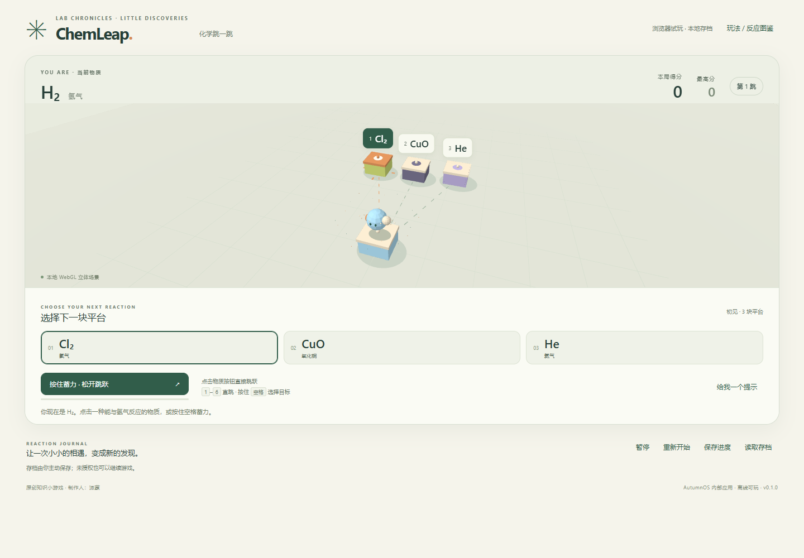

# chemleap

**ChemLeap · 3D 化学跳一跳**，制作人：派蒙。版本 `0.1.0`。

从 H₂ 出发，在三维平台之间选择能发生反应的物质。成功反应后变成生成物并加分；选错则结束。每轮生成 3～6 个平台，保证 1～2 个有效选项，分数越高干扰项越多。包含蓄力跳跃、反应粒子、图鉴、暂停、重开和最高分存档。



## 下载与 AutumnOS 内部试玩

[下载 ChemLeap-0.1.0.autumn](https://github.com/paimeng5201314/chemleap/releases/download/v0.1.0/ChemLeap-0.1.0.autumn)（28,872 字节）。这是 AutumnOS 内部应用包，需要兼容的 AutumnOS 客户端。

1. 在 AutumnOS 设置中启用开发者模式，打开开发者工具。
2. 使用“选择并检查 .autumn”选中下载的包，进入内部预览并确认。
3. 点击物质按钮或按数字键 1～6 跳跃，也可按住空格蓄力，松开起跳。左右键选择目标。

已验证的宿主内部版本为 `0.5.1-local.8`，SDK `0.3.0`。当前可玩路径是明确确认后的**开发者预览**；宿主普通社区启动的安全门禁仍保留。

游戏已公开发布为 [v0.1.0](https://github.com/paimeng5201314/chemleap/releases/tag/v0.1.0)，包含 `.autumn` 包、`autumn.release.json` 和 `SHA256SUMS` 三个附件；仓库已设置商店 Topics `autumnos-app`、`autumn-app-sq`。兼容 AutumnOS 可刷新商店搜索 ChemLeap，或通过“打开 GitHub 仓库”粘贴本仓库链接查看版本。普通社区运行仍遵循宿主安全门禁。[接入与发布说明](docs/chemleap-integration.md)。

## 本地开发

游戏无 npm 运行依赖、无 CDN、无运行时网络请求，使用 WebGL 三维渲染；WebGL 不可用时明确显示 Canvas2D 降级。模型测试只需要 Node.js：

```powershell
node --test tests/chemleap-model-tests.cjs
```

浏览器预览可在仓库根执行下面命令，再打开 `http://127.0.0.1:8080/`。浏览器使用本机 localStorage；AutumnOS 内使用宿主 SDK 存档，两者分开。

```powershell
python -m http.server 8080 --bind 127.0.0.1 --directory samples/chemleap
```

## 文件说明

- `samples/chemleap/`：完整游戏、固定 SDK 副本、应用清单。
- `tests/chemleap-model-tests.cjs`：50 项独立模型测试。
- `docs/chemleap-game.md`：方案、结构、核心代码说明、15 条反应、平台与蓄力规则。
- `docs/TESTING.md`：实际测试范围、结果与未验证项。
- `autumn.store.json`：商店展示清单；`dist/`：安装包、版本清单与校验值。
- `source-manifest.json`：8 个运行文件的实际字节哈希。
- `release/v0.1.0/RELEASE_NOTES.md`：准备好的 Release 说明与附件清单。

包 SHA-256：`3a9f2f4e977e7adafec424df3223e19e3ddb5a7f14ce1c0005c88212552e8598`。

只申请 `saves` 权限；不请求宿主身份或网络能力。反应按图鉴注明的教学条件抽象处理。仓库目前没有声明独立开源许可证。
